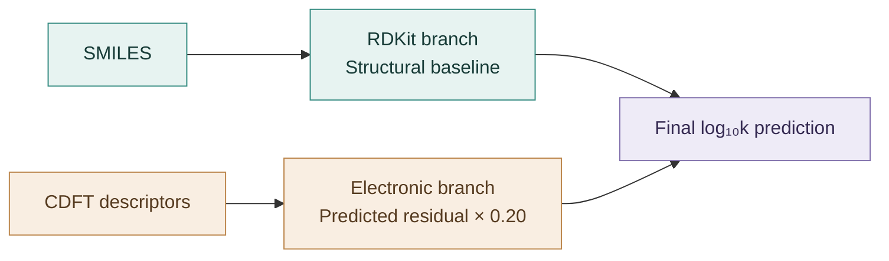

# Singlet-Oxygen Reactivity: Structure, Electronics and Residual Learning

**A research companion for interpretable prediction of organic pollutant reactivity toward singlet oxygen (¹O₂).**

This repository introduces the study's RDKit–CDFT residual-learning framework and provides a runnable SMILES workflow example for exploring structure-based screening.

[Companion web application](https://grace-li01-singlet-oxygen-rate-tendency-predictor.hf.space)

## Research overview

The study combines molecular structure and electronic properties to predict second-order reaction rate constants, expressed as log₁₀*k* with *k* in M⁻¹ s⁻¹.

- **Structural baseline:** 29 RDKit descriptors capture functional groups, molecular frameworks and physicochemical properties.
- **Electronic correction:** 20 conceptual density functional theory (CDFT) descriptors model the structural branch's out-of-fold residuals, scaled by a fixed coefficient of 0.20.
- **Chemical interpretation:** SHAP attribution, response surfaces and individual prediction decompositions connect the model's internal decisions with structure–reactivity relationships.

### How the two branches work together

The study's prediction architecture separates structural recognition from electronic refinement:



**Final prediction = structural baseline + 0.20 × predicted electronic residual**, with both contributions expressed on the log₁₀*k* scale.

Learning residuals focuses the electronic branch on molecule-specific departures from the structural baseline. On the original rate scale, this correction becomes a multiplicative adjustment to the baseline rate. This connects the computational design to a chemical question: how does a molecule's electronic environment shift its reactivity relative to the expectation from its structure?

Internal decision analysis follows this decomposition. Two-dimensional response surfaces examine how electronic responses vary with structural context, while individual prediction analyses show the direction and magnitude of the electronic adjustment.

### Performance at a glance

The study uses **176 compounds**, divided into training, validation and test sets of **122, 27 and 27**. Five-fold cross-validation within the training set supports hyperparameter tuning, followed by validation-set selection and test-set evaluation.

| Model route reported in the study | Test R² | Test RMSE (log₁₀*k*) |
|---|---:|---:|
| RDKit single-branch comparison | 0.759 | 0.816 |
| **RDKit–CDFT residual fusion** | **0.879** | **0.602** |

These results demonstrate the predictive value of combining structural information with targeted electronic correction. Applicability-domain analysis and experimental comparisons further connect model evaluation with chemical interpretation and practical screening.

## Two application modes

The companion web application organizes prediction around the molecular information available:

| Mode | Input | Output and purpose |
|---|---|---|
| **Structure-based screening** | SMILES | Reactivity bands and structural support for prioritizing candidate pollutants. |
| **CDFT-assisted prediction** | SMILES and 20 CDFT descriptors | Quantitative log₁₀*k* predictions from the full residual-fusion framework. |

The study applies structure-based screening to **384 candidate pollutants across 21 chemical classes**, connecting molecular-level interpretation with candidate selection for further investigation.

## Quick start

Use **Python 3.10 or later** and run these commands from the directory containing this README:

```bash
python -m pip install -r requirements.txt
python scripts/run_demo.py
```

The example reads [`examples/example_smiles.csv`](examples/example_smiles.csv), extracts structural cues using transparent SMILES-based rules, and produces dimensionless demonstration scores, qualitative tendency bands and example applicability labels. Five molecules are supplied: phenol, aniline, pyridine, imidazole and dichlorobenzene.

A [Conda environment file](environment.yml) is also provided.

## Input and output

To explore your own structures, edit the example CSV, keeping the `molecule_id` and `smiles` columns, then rerun the command:

```csv
molecule_id,smiles
phenol,c1ccccc1O
aniline,Nc1ccccc1
```

Results are saved in `outputs/`:

- **`demo_predictions.csv`** — per-molecule structural cues, a relative score, a `low` / `medium` / `high` tendency band, an applicability label and a short structural explanation.
- **`demo_tendency_summary.png`** — a visual comparison of the example scores and tendency bands, generated with Matplotlib.

## Repository guide

| Location | Contents |
|---|---|
| [`scripts/run_demo.py`](scripts/run_demo.py) | Entry point for the example workflow. |
| [`src/qsar_showcase/`](src/qsar_showcase/) | Structural cues, example scoring, applicability labels and visualization modules. |
| [`examples/`](examples/) | Example SMILES input table. |
| `outputs/` | Generated results and summary figure. |
| [`requirements.txt`](requirements.txt), [`environment.yml`](environment.yml) | Python and Conda environment setup. |

## License

The code is available under the [MIT License](LICENSE).
